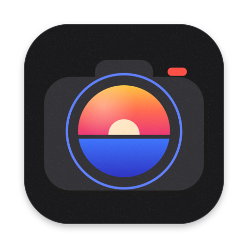
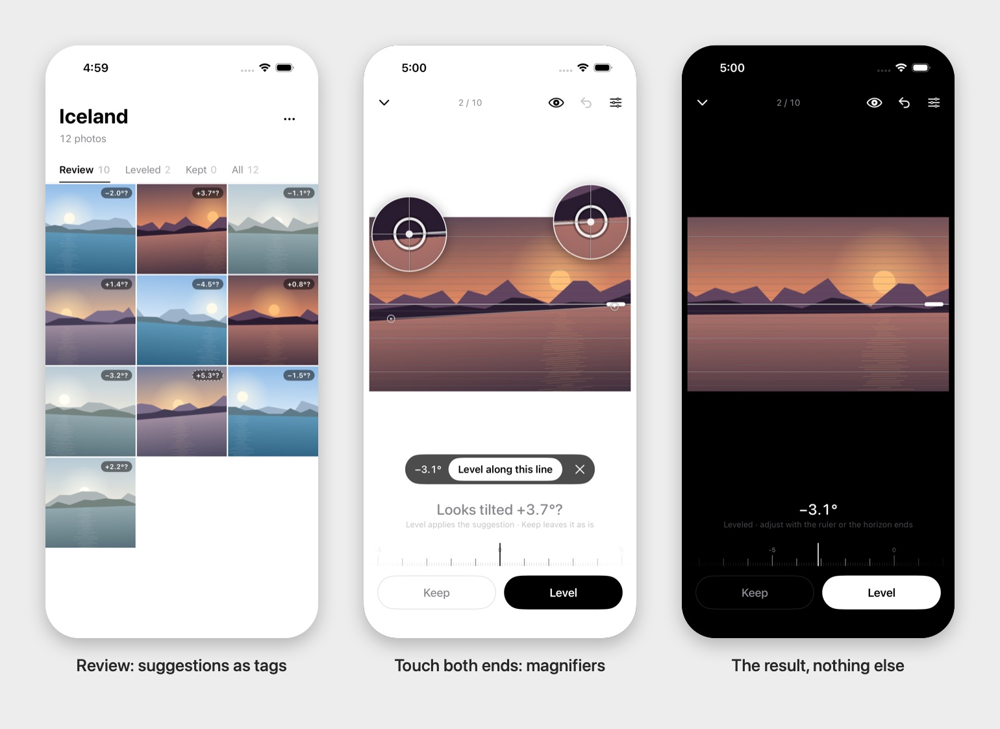
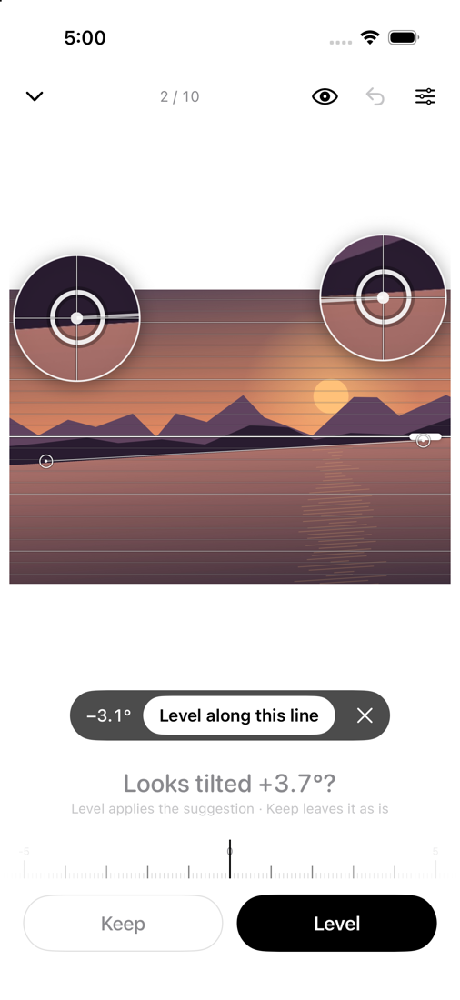
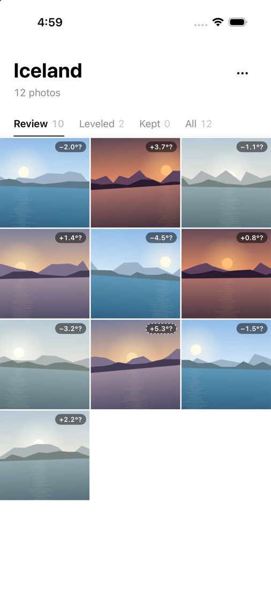
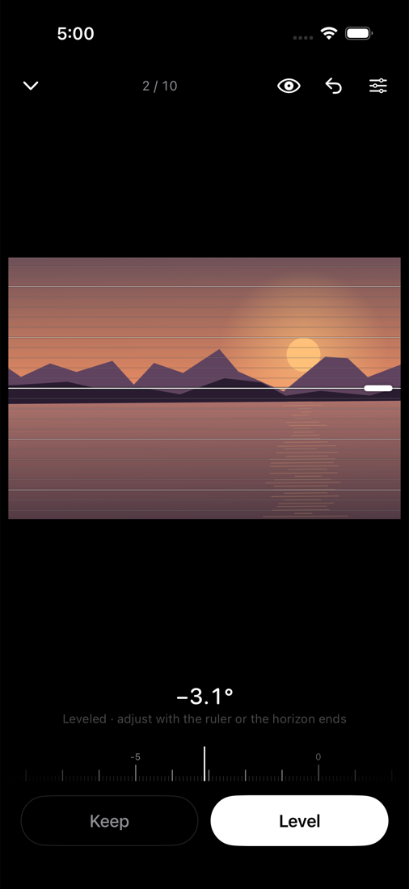
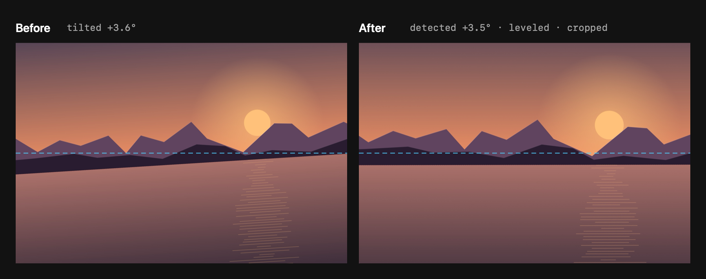
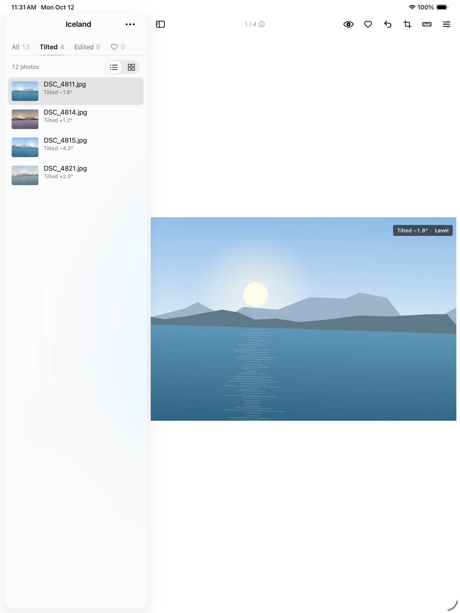

<div align="center">



# Photo Minimalist

**Preview, level, crop. Nothing else.**

A minimalist photo app for Mac, iPhone and iPad: flip through a folder or a memory card ultra fast,<br>
straighten crooked horizons in a keystroke, and crop. Native Swift, on-device, nothing uploaded. Your originals stay safe.

[](https://swift.org)
[](#get-started)
[](LICENSE)
[](#status)

<br>

[](https://github.com/vekaev/photo-minimalist/releases/latest/download/PhotoMinimalist-mac.dmg)

<sub>Universal (Apple Silicon + Intel). Not notarized yet: the first time, right-click the app → <b>Open</b>. The iPhone app builds from source (see <a href="#get-started">Get started</a>).</sub>

<br><br>



<sub>Every screenshot is the real app on generated test landscapes, captured in the iOS Simulator.</sub>

<p>
  <a href="#features">Features</a> ·
  <a href="#keyboard">Keyboard</a> ·
  <a href="#fast-on-memory-cards">Speed</a> ·
  <a href="#built-for-the-terminal">CLI</a> ·
  <a href="#under-the-hood">Under the hood</a> ·
  <a href="#get-started">Get started</a> ·
  <a href="#status">Status</a>
</p>

</div>

<br>

<table>
  <tr>
    <td width="25%" valign="top">
      <h3>👀 A previewer first</h3>
      Open a folder or a card and flip through it with the arrow keys and Space, like Finder's Quick Look. Leveling is one keystroke away, never in the way.
    </td>
    <td width="25%" valign="top">
      <h3>📐 Honest suggestions</h3>
      A quiet previewer first: the app only speaks up when it's sure. Two detectors (Apple's horizon model and a straight-line analysis) must agree, or the lines must be very clear, before a small corner chip says <i>"Tilted 1.4° · Level"</i>. Hover (iPhone: hold) to preview, click to level, Undo for a few seconds after. Nothing is ever leveled behind your back.
    </td>
    <td width="25%" valign="top">
      <h3>🔍 Precise by hand</h3>
      Open the level tool (<kbd>R</kbd> or the level button) and touch both ends of the horizon; round magnifiers show exactly where each point lands. Or drag a 0.1° ruler, with ⌥ for 0.01°.
    </td>
    <td width="25%" valign="top">
      <h3>✂️ Crop, simply</h3>
      Original, Free, 1:1, 4:5, 3:2 or 16:9 (flip for 5:4, 2:3, 9:16). Drag the corners, edges or the whole frame. It works with leveling, never against it.
    </td>
  </tr>
  <tr>
    <td width="25%" valign="top">
      <h3>🛟 Nothing to lose</h3>
      Decisions live in a small file next to your photos. Save into originals and the untouched file is backed up; Restore Original puts it back byte for byte.
    </td>
  </tr>
</table>

<br>

## Features

<table>
  <tr>
    <td width="50%" valign="top">
      
      <h3>Level along any line</h3>
      Press on one end of the horizon: a ×4 magnifier with a crosshair follows your finger or cursor. Press on the other end and both magnifiers stay up, so you can drag either end until it sits exactly on the line. Nothing rotates until you confirm, so your points never slide away.
      <br><br>
      Prefer numbers? A thin ruler with 0.1° ticks, <kbd>[</kbd> <kbd>]</kbd> for ±0.1°, <kbd>⇧</kbd> for ±1°, and a dense line overlay (or thirds) to check against.
    </td>
    <td width="50%" valign="top">
      
      <h3>Review a whole shoot</h3>
      Photos stay in shot order, so bursts stay together. Tiles stay clean: a small <b>+3.7°</b> tag only when the detectors are sure, <b>✓ −2.4°</b> once leveled, <b>Kept</b> for tilts you meant.
      <br><br>
      <kbd>L</kbd> level · <kbd>K</kbd> keep as shot · <kbd>U</kbd> undecided, on one photo or a whole selection. Or switch to <i>Biggest tilts first</i>, grouped under clear headings.
    </td>
  </tr>
  <tr>
    <td width="50%" valign="top">
      
      <h3>See the result, not the machinery</h3>
      The preview shows only the final photo: rotated and cropped edge to edge, the way it will be saved. Press <kbd>Space</kbd> (Mac) or tap the eye (iPhone) to flip to the original and back.
      <br><br>
      Monochrome, light or dark with your system, no title bar, no badges. Everything else lives in one settings panel that slides in and out.
    </td>
    <td width="50%" valign="top">
      
      <h3>Save in place, or export copies</h3>
      <b>Save to Original</b> (<kbd>⌘S</kbd>) writes the leveled photo over the JPEG, HEIC or TIFF, rendered from the untouched file every time so quality never degrades. Or export copies as JPEG, HEIC or 16-bit TIFF, cropped to the original aspect ratio, with EXIF, GPS and capture date kept.
      <br><br>
      <kbd>⌘C</kbd> copies the photo as you see it (leveled if you leveled it), <kbd>⇧⌘C</kbd> the RAW file, <kbd>⌥⌘C</kbd> the untouched original.
    </td>
  </tr>
</table>

<br>

## Everything in the box

<table>
  <tr>
    <td width="33%" valign="top">
      <h4>🗂️ Library</h4>
      Folders and subfolders · memory cards (insert one and it offers to open it: <i>Ask</i>, <i>Open automatically</i> or <i>Do nothing</i>) · several folders at once: on the Mac each in its own tab in a thin bar at the top of the window (<b>+</b> or <kbd>⌘O</kbd> opens a folder in a new tab, <kbd>⌘T</kbd> an empty tab, <kbd>⌘W</kbd> closes one, <kbd>⌘1</kbd>…<kbd>⌘9</kbd> / <kbd>⌃Tab</kbd> switch, drag to reorder; a dropped folder opens a new tab when this one is in use; all tabs reopen at launch), on iPhone <b>Recent</b> folders on the start screen and <b>Switch folder</b> in ⋯ · RAW + JPEG pairs shown as one photo with a <b>RAF</b> mark · tabs: All · Tilted (a confident tilt, not decided) · Edited (leveled or cropped) · ♥ · favorites (<kbd>F</kbd>) get Finder's Red tag on the Mac, and Red-tagged files open as favorites · <b>Add to Photos</b> imports the originals (RAW as the alternate) with favorites kept, and <b>Mark Favorites in Photos</b> hearts copies already there (Apple Photos ignores Finder tags, so this goes through PhotoKit) · shot order or biggest tilts first · <b>photo info</b>: date taken, camera and lens, focal length · aperture · shutter · ISO, pixels and file size (+ RAW), read from the file header only and cached; with the preview hidden the list shows Finder-like columns, otherwise one line under each name; <kbd>I</kbd> in the preview (iPhone: tap the ⓘ counter) shows everything · <b>your own control bar</b> above the photo: right-click it ▸ <i>Customize Controls…</i> to choose and reorder buttons (Level, Crop, ♥, Original ⇄ result, Info, History, Compare, Copy, Save, Export, Trash, Add to Photos…), optional labels; on iPhone Settings ▸ Editor buttons · list with preview, or a grid of whole photos (Lightroom-style) or cropped tiles.
    </td>
    <td width="33%" valign="top">
      <h4>📐 Leveling and crop</h4>
      Confident suggestions only (a corner chip), never auto-applied · a level tool (<kbd>R</kbd>) with the two-point picker with magnifiers · crop with ratios (Original, Free, 1:1, 4:5, 3:2, 16:9, flippable) · 0.1° ruler · guide line with ×5 loupes on both ends · fine / thirds / 12 / 24 line overlays · compare overlay, side by side or split · drag the dashed suggested horizon onto the real one · <b>crop versions</b>: save several crops (<kbd>V</kbd>), compare them side by side (<kbd>⇧C</kbd>) and pick the best · full history with jump-back · <b>folder history</b> (<kbd>⌘Y</kbd>, iPhone ⋯ ▸ History): every action in the folder, by day, searchable, with Revert (deletions come back from the Trash) · undo / redo across batches · <b>Move to Trash</b> (with the RAW twin) that <kbd>⌘Z</kbd> puts back.
    </td>
    <td width="33%" valign="top">
      <h4>📷 Formats</h4>
      JPEG, HEIC, PNG, TIFF, WebP, and RAW: Fujifilm RAF, Canon CR2/CR3, Nikon NEF, Sony ARW, DNG, Olympus ORF, Panasonic RW2, Pentax PEF and more (read through Apple's RAW support). Save into JPEG, HEIC and TIFF originals; RAW files stay as shot.
    </td>
  </tr>
</table>

## Keyboard

| Anywhere | | Preview | |
|---|---|---|---|
| <kbd>↑</kbd> <kbd>↓</kbd> <kbd>←</kbd> <kbd>→</kbd> | Move through photos | <kbd>Space</kbd> | Original ⇄ result |
| <kbd>L</kbd> / <kbd>K</kbd> / <kbd>U</kbd> | Level / keep as shot / undecided | <kbd>R</kbd> | Level tool: switch, ruler, two-point picker (<kbd>↵</kbd> / <kbd>Esc</kbd> done) |
| | | Level tool: click, click | Level through two points (<kbd>↵</kbd> apply, <kbd>Esc</kbd> cancel) |
| <kbd>⌘C</kbd> · <kbd>⇧⌘C</kbd> · <kbd>⌥⌘C</kbd> | Copy as shown · RAW · original | <kbd>[</kbd> <kbd>]</kbd> · <kbd>⇧[</kbd> <kbd>⇧]</kbd> | Rotate ±0.1° · ±1° |
| <kbd>⌘S</kbd> | Save to original (backup kept) | <kbd>0</kbd> | Reset |
| <kbd>⌘Z</kbd> / <kbd>⇧⌘Z</kbd> | Undo / redo | <kbd>G</kbd> · <kbd>T</kbd> · <kbd>H</kbd> | Lines · guide · suggested horizon |
| <kbd>S</kbd> | Settings panel | <kbd>C</kbd> | Crop (<kbd>↵</kbd> done, <kbd>Esc</kbd> cancel) |
| <kbd>F</kbd> | Favorite (♥, Red tag in Finder) | <kbd>I</kbd> | Photo info (date, camera, exposure, sizes) |
| <kbd>⌘Y</kbd> | Folder history (search, Revert, Show photo) | | |
| <kbd>⌫</kbd> / <kbd>⌘⌫</kbd> | Move to Trash (⌘Z puts it back) | Crop: <kbd>V</kbd> · <kbd>⇧C</kbd> | Save a crop version · compare versions (<kbd>1</kbd>–<kbd>9</kbd> picks) |
| ⌘-click · ⇧-click · <kbd>⌘A</kbd> | Select several (list and grid) | drag the dashed line | Move the suggested horizon (double-click resets) |
| | | Grid: <kbd>Space</kbd> | Quick look (floating) |
| <kbd>⌘+</kbd> / <kbd>⌘−</kbd> · <kbd>⌘0</kbd> | Zoom the preview in / out · fit (also pinch, <kbd>⌥</kbd>-scroll; two-finger scroll pans) | <kbd>⌥</kbd>-double-click | Fit ⇄ 2× at the pointer (works while cropping and leveling) |

On iPhone: tap a photo to open it (it zooms out of its tile), touch both ends of the horizon, tap ✂︎ to crop, swipe for the next photo, pinch to zoom (two fingers pan, double-tap fit ⇄ 2×, also while cropping), long-press a tile for a preview and the status menu, ⋯ ▸ History to see and revert everything done in the folder (swipe left on an entry).

On iPad: the photo list (or grid) and the editor sit side by side, like the Mac; a narrow Split View window gets the iPhone layout. Each window holds its own folder, so two can sit side by side (Recent ▸ right-click ▸ <i>Open in New Window</i>). With a keyboard: <kbd>←</kbd> <kbd>→</kbd> (and <kbd>↑</kbd> <kbd>↓</kbd>) change photos, <kbd>Space</kbd> original ⇄ result, <kbd>L</kbd> / <kbd>K</kbd> / <kbd>U</kbd> / <kbd>F</kbd>, <kbd>R</kbd> level tool, <kbd>C</kbd> crop, <kbd>↵</kbd> / <kbd>Esc</kbd>, <kbd>⌫</kbd> Trash, <kbd>⌘C</kbd>, <kbd>⌘Z</kbd>, <kbd>⌘O</kbd>, <kbd>⌘+</kbd> / <kbd>⌘−</kbd> / <kbd>⌘0</kbd> zoom (hold <kbd>⌘</kbd> to see them). With a pointer: hover the chip to preview, right-click for the menu, drag a photo out to another app.



## Fast on memory cards

Photo Minimalist is a previewer first, so speed matters. A modern camera card reads at about 88 MB/s in a MacBook's built-in reader, and a Fujifilm shoot is ~21 MB per JPEG and ~83 MB per RAF. So Photo Minimalist avoids reading whole files:

| What it needs | Where it comes from | Time per photo |
|---|---|---|
| List thumbnail | the JPEG's own embedded thumbnail | **4 ms** |
| Analysis and large preview | the RAW's embedded preview | **110–140 ms** (vs 264–404 ms decoding the JPEG) |
| Camera details (date, exposure, sizes) | the file's header only, then the folder's `.horizonleveler.json` | **a few ms**, once |
| Anything seen before | a disk cache on your Mac | **~0 ms** |

What's on screen loads before the background check, and the check saves each grid thumbnail as it goes. Measured on a SanDisk Extreme PRO in a MacBook's built-in reader: 969 RAW + JPEG pairs analyzed in **79 seconds**.

## Built for the terminal

The same engine runs headless:

```bash
leveler-cli analyze ~/Pictures/Iceland      # CSV: file, tilt, correction, confidence
leveler-cli export photo.jpg -2.4 out.jpg   # rotate (counter-clockwise +) and crop to fill
leveler-cli make-test /tmp/tilted           # synthetic photos with known tilts, for testing
```

## Under the hood

- **Swift + SwiftUI**, one engine (`Core/`) shared by the Mac app, the iPhone app and the CLI; the project is generated with XcodeGen.
- **Detection:** Vision's `VNDetectHorizonRequest` plus our own straight-line analysis (structure-tensor edge orientation, folded so horizons and verticals agree). A suggestion is *likely* only when they agree; readings beyond ±8° are discarded and anything over 5° is at most a *maybe*: on real shoots those were portraits and deliberate angles.
- **Rendering:** ImageIO for orientation-correct previews (including RAW embedded previews), Core Image and `CIRAWFilter` for full-quality export. The crop is the largest rectangle with the original aspect ratio, so there are never empty corners.
- **Safe files:** decisions are saved in `.horizonleveler.json` next to the photos; "Save to Original" keeps the untouched file in `.horizonleveler-originals/`.

## Get started

```bash
brew install xcodegen
git clone https://github.com/vekaev/photo-minimalist && cd photo-minimalist
scripts/build-app.sh --install        # Mac: universal app + DMG, installs to ~/Applications and opens it
```

iPhone: `xcodegen generate`, open `HorizonLeveler.xcodeproj`, pick the **HorizonLeveler-iOS** scheme, choose your team under Signing, and run it on your phone (or `scripts/run-ios-sim.sh` for the simulator).

New contributors and AI agents: start with [`CLAUDE.md`](CLAUDE.md). It holds the rules (every change ships on Mac **and** iPhone), the feature parity table and the performance notes.

## Status

Photo Minimalist is early, and we want to be straight about it:

- **Detection is a helper, not an oracle.** On a real 969-photo shoot the detectors had some reading for 560 photos; only the 163 they're sure about (17 %) get a suggestion, the rest stay quiet. The level tool levels any of those by hand.
- **RAW files can't be rewritten.** Saving into originals changes the JPEG; the RAF stays as shot. XMP sidecars for Lightroom are on the roadmap.
- **Not notarized yet**, and the iPhone app isn't on the App Store; build it from source.
- **Experimental (Mac):** Settings ▸ Advanced ▸ *Film scan fixes* (off by default) removes the dark shutter bands a Leica M6 left near the edges of some film scans, non-destructively.

## Roadmap

- A line-segment detector with a consensus check, and perspective (vanishing point) awareness, after [LightCraft](https://github.com/storytold/lightcraft)'s `upright.rs`, to cut false suggestions on buildings and interiors.
- Face awareness: close-up portraits become *maybe* at most.
- XMP sidecars, so Lightroom, Capture One and darktable pick up the rotation.
- "Import to Mac": copy a card to the local drive first, about 30× faster to work with.
- Ratings and pick / reject flags, for culling while you level (favorites are done).

## Acknowledgements

The README layout and several roadmap ideas (consensus-checked line detection, embedded-preview culling) are inspired by the open-source Crafting Apps, [PhotoCraft](https://github.com/storytold/photocraft) and [LightCraft](https://github.com/storytold/lightcraft) by the ArtCraft team (MIT / Apache-2.0). No code is copied yet; anything we port will be credited here and in the source.

<sub>Formerly “Horizon Leveler”. The repository, the CLI (`leveler-cli`) and internal names still use the old name for now.</sub>

## License

[MIT](LICENSE): free to use, modify and share.
